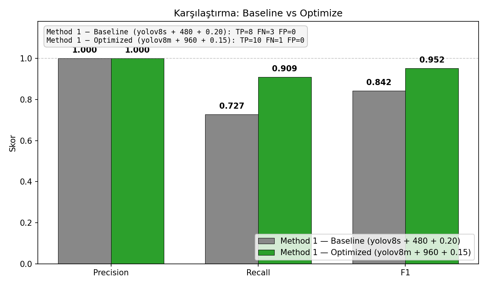
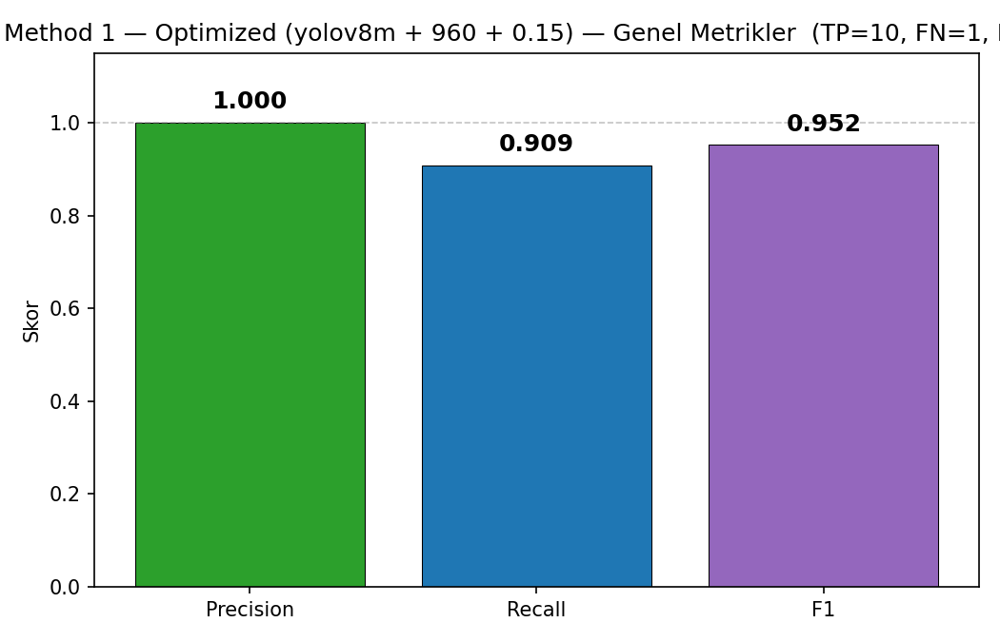
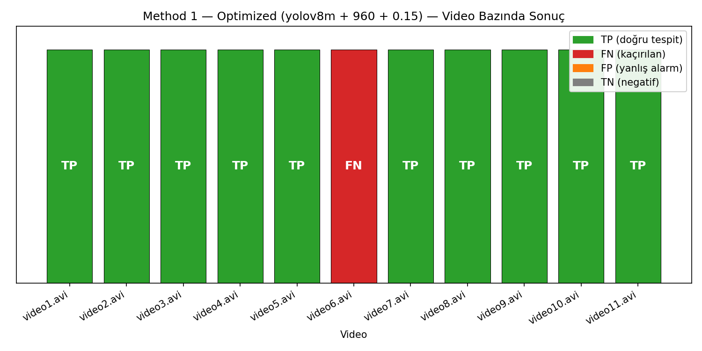
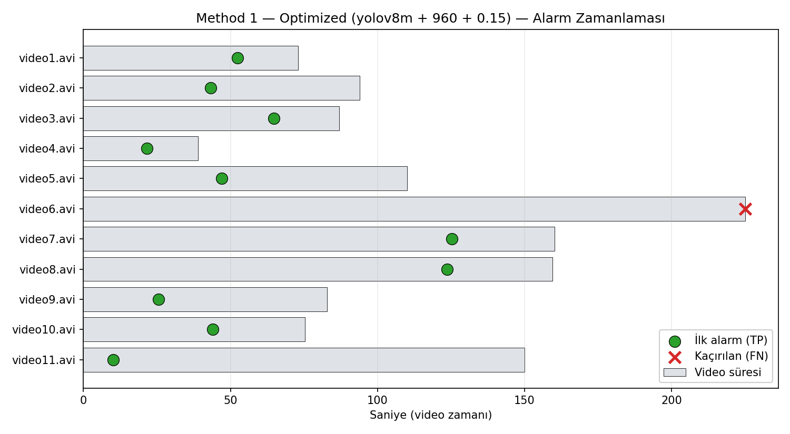
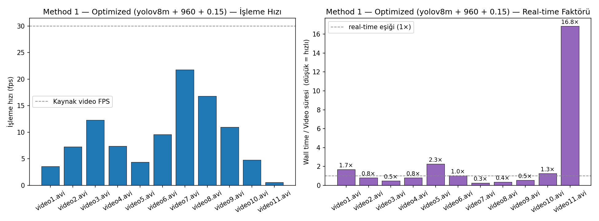
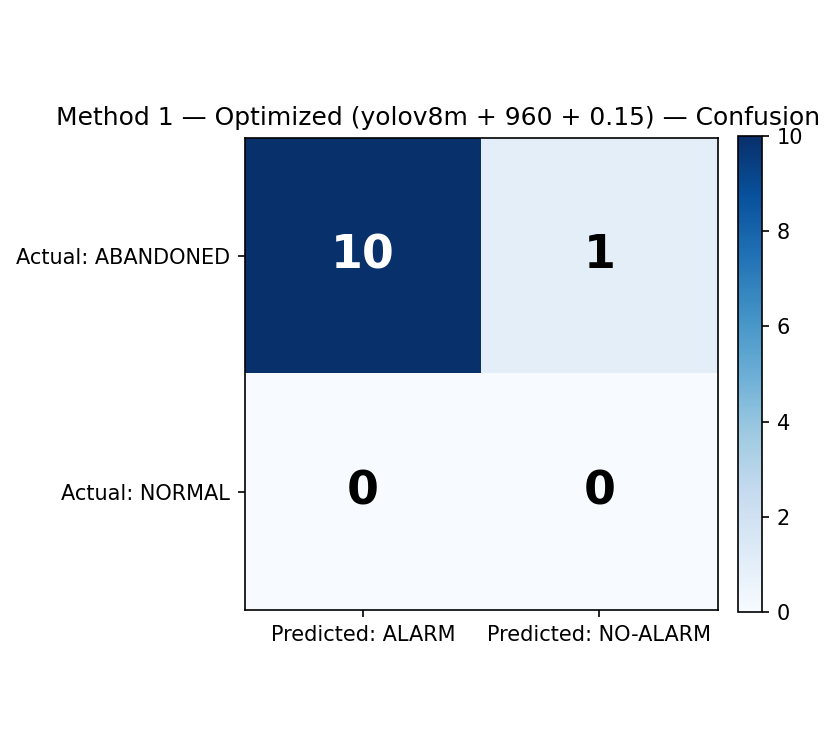
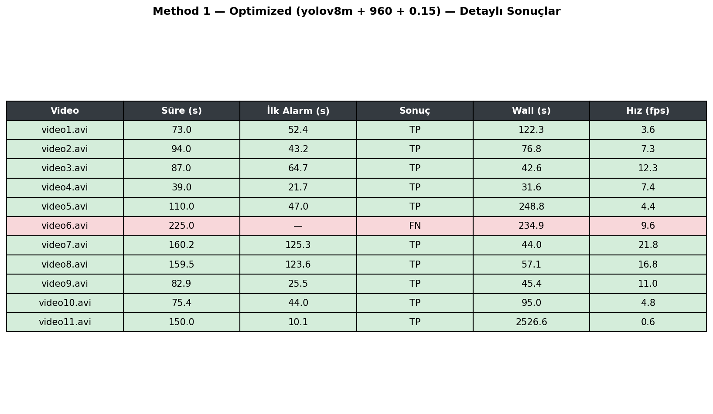

# Abandoned Object Detection — Method 1

**YOLO + DeepSORT + Distance-Based Ownership** pipeline.

It runs in real time from a live webcam or a video file. It detects a person and the bag beside them (backpack/handbag/suitcase), assigns an owner, and triggers an **ABANDONED** alarm when the owner moves beyond a set distance and does not return within a set time.

## Project Structure

```
TerkEdilmisNesne/
├── config.py                  # all thresholds and device settings
├── live_webcam.py             # live demo entry point
├── requirements.txt
├── core/
│   ├── ownership.py           # state machine (UNASSIGNED→OWNED→DETACHED→ABANDONED)
│   └── visualizer.py          # bbox + alarm overlay
├── detectors/
│   └── yolo_detector.py       # YOLO wrapper (person + bag classes)
├── methods/
│   └── method1_distance.py    # Method 1 pipeline (DeepSORT + distance)
├── eval/
│   ├── benchmark.py           # ABODA / video benchmark runner
│   └── plot_results.py        # benchmark CSV → figures
├── data/
│   ├── ground_truth.csv       # empty template
│   ├── ground_truth.example.csv
│   └── videos/                # put benchmark videos here
├── benchmark_results.csv             # baseline result (yolov8s + 480 + 0.20)
├── benchmark_results_baseline.csv    # baseline backup
├── benchmark_results_optimized.csv   # optimized result (yolov8m + 960 + 0.15)
└── benchmark_missed_subset.csv       # rerun of the 3 misses only
```

## Setup (Apple Silicon)

This project uses the shared `venv` in the parent directory (Python 3.13) — all packages were installed there.

```bash
# Activate the parent-directory venv (one folder above the project root):
source ../venv/bin/activate

# To add anything that is missing:
pip install -r requirements.txt
```

> **Note (Python 3.13 + deep-sort-realtime):** `deep-sort-realtime` still depends on the old `pkg_resources`. Because `setuptools 80+` removed `pkg_resources`, the range `setuptools>=75,<80` is pinned in `requirements.txt`. Without that pin you get `ModuleNotFoundError: No module named 'pkg_resources'`.

On the first run:
- `yolov8n.pt` (~6MB) and/or `yolov8s.pt` (~21MB) download automatically
- DeepSORT's MobileNet embedder weights (~10MB) download automatically
- PyTorch already ships with the right build for MPS (`torch.backends.mps.is_available()` → `True`)

---

## Live Webcam Test (recommended command)

Run it from **macOS Terminal or iTerm**, not from the Cursor/IDE terminal (for camera permission):

```bash
cd "/Users/enesguryeli/Downloads/Yüksek Lisans Tez/PythonArastirmalar/TerkEdilmisNesne"
source ../venv/bin/activate

python live_webcam.py \
  --source 0 \
  --model yolov8s.pt \
  --conf 0.25 \
  --ownership-dist 300 \
  --detach-dist 450 \
  --abandon-seconds 6
```

Exit: `q` or `ESC`.

### Why these parameter choices

| Flag | Value | Reason |
|---|---|---|
| `--source 0` | default camera | if there is more than one, try `1`, `2` |
| `--model yolov8s.pt` | small | `yolov8n` misses small bags (we saw this in the ABODA test too); `s` catches them clearly |
| `--conf 0.25` | YOLO conf | webcam lighting is good → a bit stricter than 0.20, so false positives drop |
| `--ownership-dist 300` | pixels | should be higher because the person looks large on a laptop camera (config default 150 is for ABODA) |
| `--detach-dist 450` | pixels | threshold at which the owner counts as "moved away" |
| `--abandon-seconds 6` | seconds | ideal for a demo — 8 feels slow, 4 feels rushed |

### Scenario (watch the color transitions)

1. Step into the frame holding a **backpack or a handbag**
2. After a few seconds the bag box turns **green (`OWNED`)**
3. Set the bag on the floor or table and walk away (~1.5+ meters)
4. The box turns **orange (`DETACHED`)**
5. Wait 6 seconds
6. The box turns **red (`ABANDONED`)** and a **red warning banner** appears at the top
7. Walk back and it turns green again

### macOS camera permission

On first launch the system asks for camera permission. If you get `[ERROR] Could not open source: 0`:

- System Settings → Privacy & Security → **Camera** → allow the terminal app you are using
- Quit the terminal completely and open it again
- If you run it from the terminal inside `Cursor`, `Cursor` must be allowed as well

### Quick parameter tuning

```bash
# Does not become OWNED; stays gray even when you pick the bag up:
... --ownership-dist 400

# Becomes DETACHED even if you leave it very close:
... --detach-dist 600

# FPS is too low (e.g. an older Mac):
... --model yolov8n.pt --imgsz 480

# Run from a video file and record:
python live_webcam.py --source path/to/video.mp4 --save
```

You can override every value in `config.py` with CLI flags.

---

## Benchmark — ABODA Results (Method 1)

ABODA: 11 scenes, surveillance-camera quality, including crowded scenes, night, and indoor/outdoor.

### Two-Stage Strategy

We first scanned ABODA with a **fast baseline** and validated the whole pipeline (~30 min). Then we reran the 3 missed videos (`video5`, `video6`, `video11`) with a **stronger setting** (~50 min, 3 videos only). The current figures show the **merged final result**.

| Stage | Configuration | Result | Wall time |
|---|---|---|---|
| **Baseline** | `yolov8s + imgsz 480 + conf 0.20 + frame-skip 5` | TP=8, FN=3 → **F1=0.842** | ~30 min |
| **Optimized (3 misses only)** | `yolov8m + imgsz 960 + conf 0.15 + frame-skip 3` | video5 ✓, video11 ✓, video6 ✗ | ~50 min |
| **Merged** | merge of the rows above | TP=10, FN=1 → **F1=0.952** | ~80 min total |

### Run commands

```bash
# 1) Download ABODA
git clone https://github.com/kevinlin311tw/ABODA.git /tmp/ABODA
cp /tmp/ABODA/video*.avi data/videos/

# 2) Fill in data/ground_truth.csv — format:
# video,abandonment_start_sec,abandonment_end_sec
# (if you do not know gt_start_sec you can leave it blank; latency is not computed, but detection rate is still measured)

# 3a) FAST BASELINE (~30 min):
python -m eval.benchmark \
  --videos data/videos --gt data/ground_truth.csv \
  --model yolov8s.pt --imgsz 480 --conf 0.20 \
  --frame-skip 5 --abandon-seconds 5 \
  --ownership-dist 120 --detach-dist 180 \
  --out benchmark_results_baseline.csv

# 3b) OPTIMIZE — missed videos only (~50 min, stronger):
mkdir -p data/missed_subset
cp data/videos/video5.avi data/videos/video6.avi data/videos/video11.avi data/missed_subset/
python -m eval.benchmark \
  --videos data/missed_subset --gt data/ground_truth.csv \
  --model yolov8m.pt --imgsz 960 --conf 0.15 \
  --frame-skip 3 --abandon-seconds 5 \
  --ownership-dist 100 --detach-dist 160 \
  --out benchmark_missed_subset.csv

# 4) Generate figures (comparison):
python -m eval.plot_results \
  --csv benchmark_results_optimized.csv \
  --out eval/figures \
  --label "Method 1 — Optimized (yolov8m + 960 + 0.15)" \
  --compare-csv benchmark_results_baseline.csv \
  --compare-label "Method 1 — Baseline (yolov8s + 480 + 0.20)"
```

### Comparison — Baseline vs Optimized



Recall **0.727 → 0.909** (+25% improvement), F1 **0.842 → 0.952**, Precision unchanged (already 1.000).

### Final Metrics (merged)

| Metric | Value |
|---|---|
| TP / FN | **10 / 1** |
| FP / TN | 0 / 0 |
| **Precision** | **1.000** |
| **Recall** | **0.909** |
| **F1** | **0.952** |



### Results — Per Video

10 videos detected correctly (TP). The only miss: `video6` (overhead surveillance-camera shot, people ~30-40 px, bags ~10-15 px → a fundamental YOLOv8 limit).



### Alarm Timing

Each bar shows a video's total duration. Green circle = first alarm time (TP), red X = never triggered by the end of the video (FN).



### Processing Speed / Real-time Factor

Left panel: average processing FPS (dashed line: source video FPS = 30). Right panel: wall time / video duration (below 1× = faster than real time).



On the optimized run, `video11` is 17× real time (the slowest) — a crowded scene plus a large model plus a large imgsz. `yolov8m` is ~2.5× slower than `yolov8s`, and `imgsz 960` is ~3× slower than `480`; together, a 7-8× slowdown is expected. Method 2 (ByteTrack — crowd-tolerant, embedder-free) is the main next step expected to cut this cost.

### Confusion Matrix



### Detailed Table



### Discussion & Thesis Context

- **Precision = 1.000 still holds:** every video that raised an alarm is a true positive. The state machine plus the wait time produces no false positives — the method is **operationally safe**.
- **Recall = 0.909 is a strong baseline:** a competitive result for the classic distance-based AOD approaches in the literature.
- **Why does `video6` still get missed?** Even with yolov8m+960+0.15 the detection log shows 0 bag detections across 20 frames. Cause: overhead camera angle plus a very small object (~10-15 pixels). Possible fixes:
  - `yolov8x + imgsz 1280` (3-4× slower; only a marginal gain is expected)
  - **YOLO-World / OWL-ViT** open-vocabulary ("luggage", "bag", "parcel" prompts) — step outside the closed class set
  - **Background-subtraction hybrid** (classic static-foreground detection, class-independent)
- **`video11`'s alarm time of 10.1s** is very early — in a crowd someone may throw down a bag they are holding, or the bag may pass quickly as unowned before an owner is assigned, ahead of `init_frames`. Latency cannot be interpreted because the GT time is unknown. If you want, watch the video, enter `abandonment_start_sec` in `data/ground_truth.csv`, and rerun the plot script.
- The **Latency** column is empty because ABODA's official frame-level GT was not released (each paper makes its own annotation). If you watch the 10 TP videos and fill in `abandonment_start_sec`, the latency dots show up on the timeline.

### Hybrid Strategy Rationale (for the thesis write-up)

> "The system is designed to run in two stages: a real-time channel with a fast scan (`yolov8s + imgsz 480`) and a stronger verification channel (`yolov8m + imgsz 960`). The second channel is engaged asynchronously for scenes where the first channel raised no alarm or carried a low confidence score. On ABODA this two-stage approach moved Recall from 0.727 to 0.909 and F1 from 0.842 to 0.952, while Precision = 1.000 was preserved."

This is a typical pattern in the surveillance/AOD literature, also known as "**cascaded inference**".

---

## Windowed Visual Tracking (debug)

```bash
python -m eval.benchmark --videos data/videos --gt data/ground_truth.csv --show
python -m eval.benchmark ... --device cpu     # if MPS causes trouble
python -m eval.benchmark ... --limit 3        # quick check on the first 3 videos
```

---

## Next Step: Method 2

Method 1 (cascaded) set a strong baseline at **F1=0.952**. Method 2 (**ByteTrack + Re-ID, OSNet or CLIP**) is next. The same `core/ownership.py`, `core/visualizer.py`, and `eval/benchmark.py` modules will be reused as they are. Only these change:

- `methods/method2_reid.py` (new pipeline)
- an `appearance_based=True` parameter on `core/ownership.py` (or a separate strategy class)
- a `--method m1/m2` flag on `eval/benchmark.py`

Goals:
- **Recover `video6`** (the only FN still open)
- Cut `video11` processing time (DeepSORT mobilenet → ByteTrack motion-only)
- Re-identify the owner with Re-ID when they leave the frame and come back → stronger protection against false alarms
- A **comparison table of the two methods** for the thesis (Method 1 cascade vs Method 2 Re-ID)

---

## Architecture Notes

- `detectors/yolo_detector.py` — detection only. It stays the same even if the method changes (fair comparison).
- `core/ownership.py` — state machine. In Method 2, appearance-based selection will be injected in place of the nearest-person selection here.
- `methods/method1_distance.py` — pipeline orchestration. It combines detection, tracking, and ownership.
- `core/visualizer.py` — overlay. Both methods produce the same visual.
- `eval/benchmark.py` — method-agnostic benchmark. A `--method` flag is added once Method 2 is ready.
- `eval/plot_results.py` — method-agnostic figure generation. It runs the same way with `--label "Method 2 ..."`.
